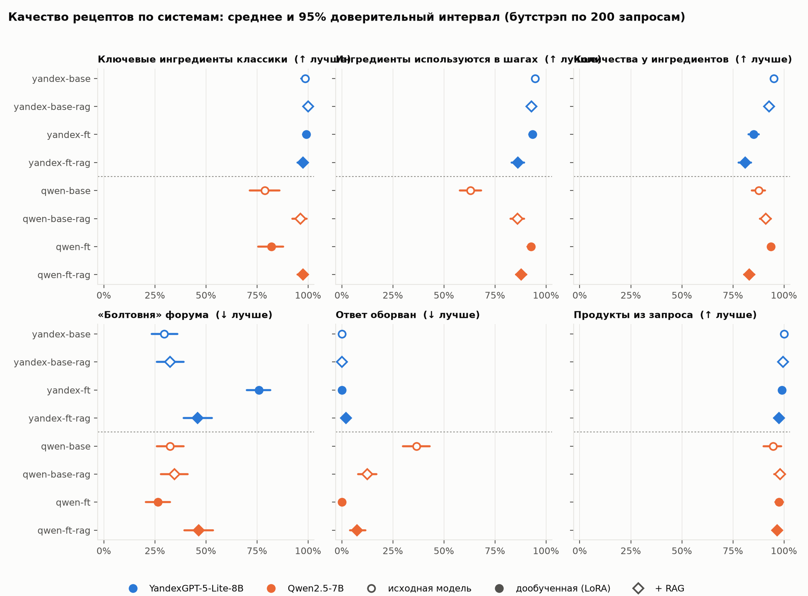
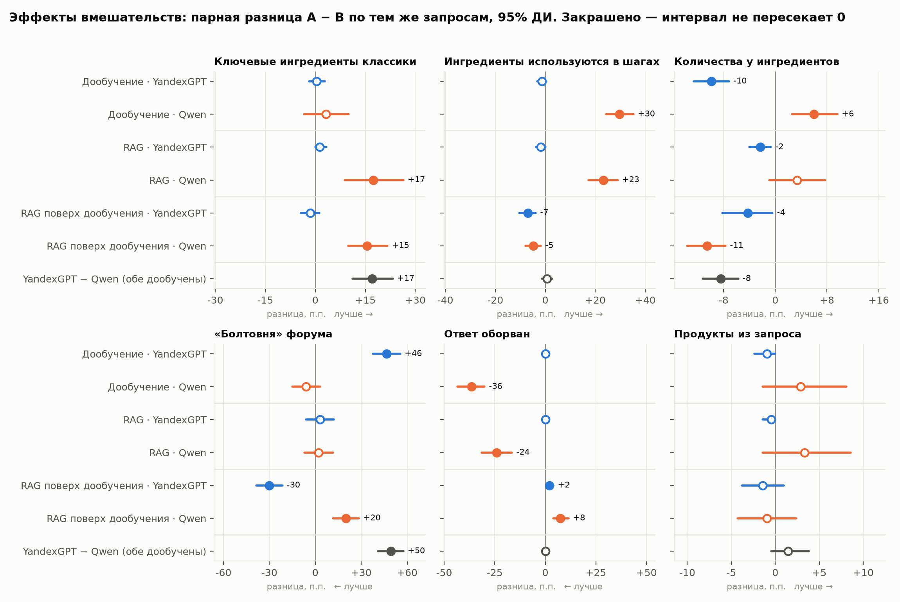
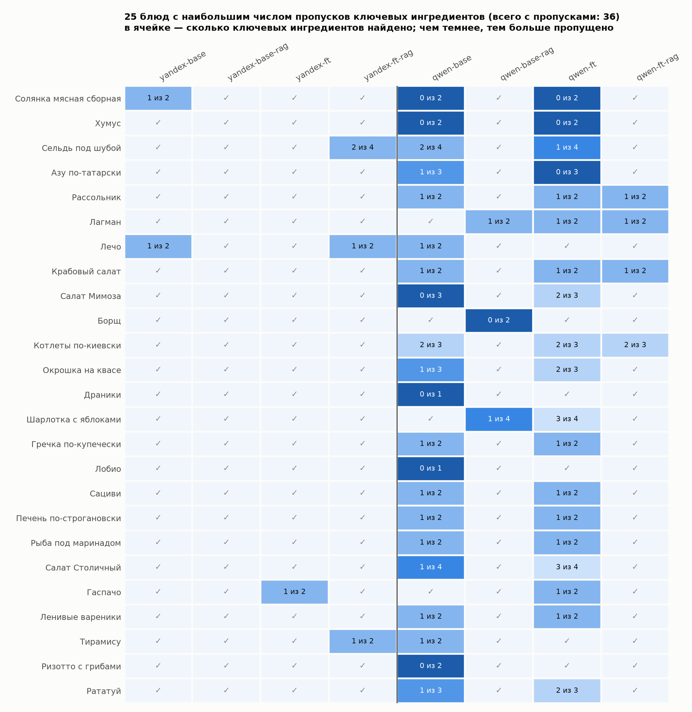
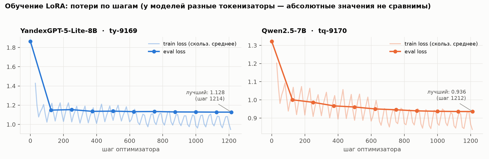
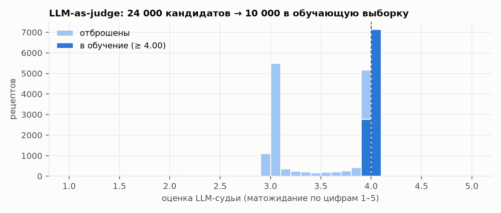
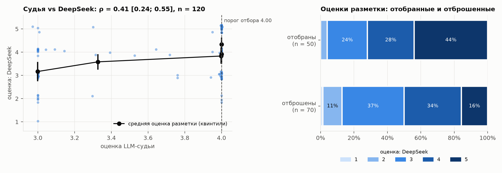

# Отчёт об оценке

Набор: `eval/prompts.jsonl` — 200 запросов (75 классических блюд, 70 наборов продуктов, 55 категорий), жадное декодирование. Интервалы — 95% перцентильный бутстрэп по запросам, B = 10000. Метрика «ключевые ингредиенты» считается по 75 блюдам, «продукты из запроса» — по 70 наборам, остальные — по всем 200 запросам.

## Метрики по системам

| Система | Ключевые ингредиенты классики ↑ | Продукты из запроса использованы ↑ | Ингредиенты используются в шагах ↑ | У ингредиентов есть количества ↑ | «Болтовня» форума ↓ | Ответ оборван ↓ | Структура рецепта ↑ |
|---|---|---|---|---|---|---|---|
| `yandex-base` | 99% [97%–100%] | 100% [100%–100%] | 95% [93%–96%] | 95% [94%–96%] | 30% [24%–36%] | 0% [0%–0%] | 100% [100%–100%] |
| `yandex-base-rag` | 100% [100%–100%] | 100% [99%–100%] | 93% [91%–94%] | 93% [91%–94%] | 32% [26%–39%] | 0% [0%–0%] | 100% [100%–100%] |
| `yandex-ft` | 99% [97%–100%] | 99% [98%–100%] | 93% [92%–95%] | 85% [83%–88%] | 76% [70%–82%] | 0% [0%–0%] | 100% [98%–100%] |
| `yandex-ft-rag` | 98% [95%–100%] | 98% [95%–100%] | 86% [83%–89%] | 81% [78%–84%] | 46% [39%–53%] | 2% [0%–4%] | 97% [94%–99%] |
| `qwen-base` | 79% [71%–86%] | 95% [90%–99%] | 63% [58%–68%] | 88% [84%–91%] | 32% [26%–39%] | 36% [30%–43%] | 92% [88%–96%] |
| `qwen-base-rag` | 96% [92%–99%] | 98% [95%–100%] | 86% [83%–89%] | 91% [88%–94%] | 34% [28%–41%] | 12% [8%–17%] | 94% [91%–98%] |
| `qwen-ft` | 82% [76%–88%] | 98% [96%–100%] | 93% [91%–94%] | 94% [92%–95%] | 26% [20%–32%] | 0% [0%–0%] | 100% [100%–100%] |
| `qwen-ft-rag` | 98% [95%–100%] | 97% [94%–99%] | 88% [85%–90%] | 83% [80%–86%] | 46% [40%–54%] | 8% [4%–12%] | 98% [96%–100%] |

## Эффекты: парные разницы

Разница A − B в процентных пунктах по одним и тем же запросам. ✅/⚠️ — интервал не пересекает 0 (✅ — в лучшую сторону, ⚠️ — в худшую); пусто — эффект не отличим от шума.

| Сравнение (A − B) | Ключевые ингредиенты классики | Продукты из запроса использованы | Ингредиенты используются в шагах | У ингредиентов есть количества | «Болтовня» форума | Ответ оборван | Структура рецепта |
|---|---|---|---|---|---|---|---|
| Дообучение · YandexGPT `yandex-ft` − `yandex-base` | +0 [-2; +3] | -1 [-2; +0] | -1 [-3; +0] | ⚠️ -10 [-13; -7] | ⚠️ +46 [+38; +56] | +0 [+0; +0] | -0 [-2; +0] |
| Дообучение · Qwen `qwen-ft` − `qwen-base` | +3 [-3; +10] | +3 [-1; +8] | ✅ +30 [+24; +35] | ✅ +6 [+3; +10] | -6 [-15; +3] | ✅ -36 [-44; -30] | ✅ +8 [+4; +12] |
| RAG · YandexGPT `yandex-base-rag` − `yandex-base` | +1 [+0; +3] | -0 [-1; +0] | -2 [-4; +0] | ⚠️ -2 [-4; -1] | +3 [-6; +12] | +0 [+0; +0] | +0 [+0; +0] |
| RAG · Qwen `qwen-base-rag` − `qwen-base` | ✅ +17 [+9; +26] | +3 [-1; +9] | ✅ +23 [+17; +29] | +3 [-1; +8] | +2 [-7; +12] | ✅ -24 [-32; -16] | +2 [-2; +8] |
| RAG поверх дообучения · YandexGPT `yandex-ft-rag` − `yandex-ft` | -2 [-4; +1] | -1 [-4; +1] | ⚠️ -7 [-10; -4] | ⚠️ -4 [-8; -0] | ✅ -30 [-38; -22] | ⚠️ +2 [+0; +4] | -2 [-5; +0] |
| RAG поверх дообучения · Qwen `qwen-ft-rag` − `qwen-ft` | ✅ +15 [+10; +22] | -1 [-4; +2] | ⚠️ -5 [-8; -2] | ⚠️ -11 [-14; -8] | ⚠️ +20 [+12; +28] | ⚠️ +8 [+4; +12] | -2 [-4; +0] |
| YandexGPT − Qwen (обе дообучены) `yandex-ft` − `qwen-ft` | ✅ +17 [+11; +23] | +1 [-0; +4] | +1 [-1; +3] | ⚠️ -8 [-11; -6] | ⚠️ +50 [+41; +57] | +0 [+0; +0] | -0 [-2; +0] |

## Где ошибаются модели: классические блюда

Хотя бы одна система пропустила ключевой ингредиент в 36 из 75 блюд; на рисунке — 25 блюд с наибольшим числом пропусков.

## Обучение

- **YandexGPT-5-Lite-8B** (`ty-9169`): eval loss 1.865 → 1.128 (лучший на шаге 1214 из 1214); после шага 125: 1.149.
- **Qwen2.5-7B** (`tq-9170`): eval loss 1.322 → 0.936 (лучший на шаге 1212 из 1212); после шага 125: 1.001.

## Данные: отбор LLM-судьёй

24 000 рецептов-кандидатов оценены базовой YandexGPT; в обучение вошли 10 000 лучших (оценка ≥ 4.00).

## Проверка судьи независимой разметкой: DeepSeek

120 рецептов, стратифицированных по оценке судьи (поровну из каждого дециля, поэтому выборка репрезентативна), оценены вслепую по шкале 1–5; разметчик: DeepSeek. В скобках — 95% бутстрэп-интервал.

| Показатель | Значение |
|---|---|
| ρ Спирмена (судья vs DeepSeek) | 0.41 [0.24; 0.55] |
| AUC: судья отличает хорошие (≥ 4 по разметке) от остальных | 0.69 [0.59; 0.78] |
| AUC: судья отличает плохие (≤ 2 по разметке) от остальных | 0.75 [0.57; 0.90] |
| Доля плохих (≤ 2) среди отобранных / отброшенных | 4% [0%; 10%] / 13% [5%; 21%] |
| Доля хороших (≥ 4) среди отобранных / отброшенных | 72% [59%; 84%] / 50% [38%; 62%] |

